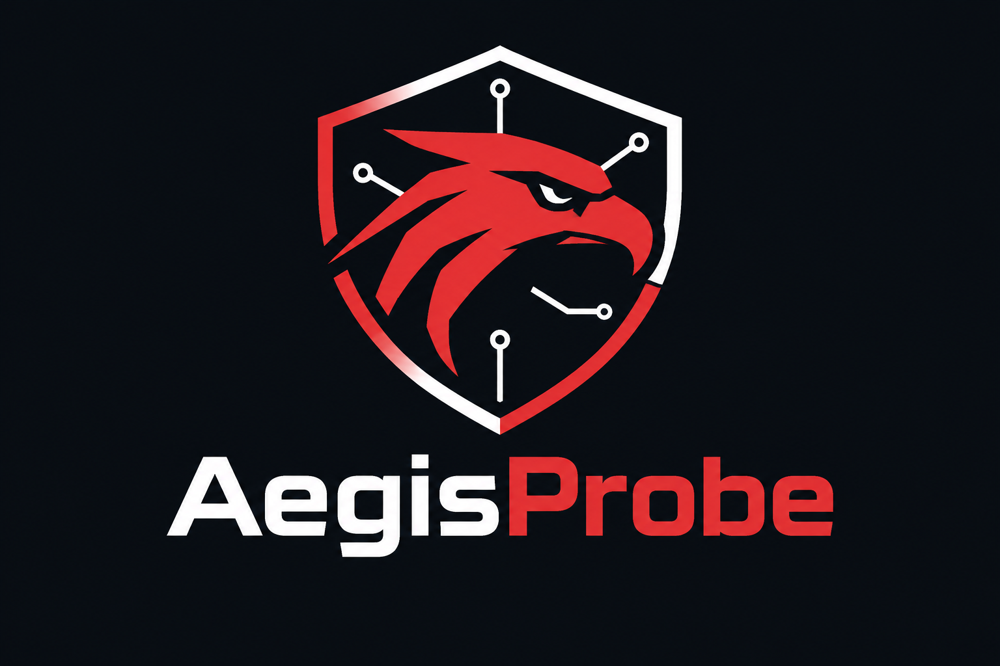

  

# AegisProbe - Red Team Web Security Toolkit

> Use only with prior written authorization from the system owner.
> AegisProbe performs active security testing against web applications.
> Unauthorized use is illegal in most jurisdictions (including the EU
> Cybercrime Directive, the U.S. CFAA, and the UK Computer Misuse Act)
> and can lead to criminal prosecution and civil liability.

AegisProbe is a single Bash script (aegisprobe.sh) that builds one Docker
image once, then runs a battery of free and open-source security tools plus
a set of custom checks against a login page of a web shop. At the end of a
run it produces one password-protected PDF report
(AegisProbe-Report-Protected.pdf) written for a mixed audience of
management and IT staff, with the AegisProbe logo on every page.

Table of contents

1. Who is this for
2. What it does - in plain language
3. Why it adds value
4. Requirements
5. Installation
6. Usage
7. How the logo works (and how to replace it)
8. Security and operational warnings
9. Legal considerations
10. Troubleshooting
11. Disclaimer

1. Who is this for

Business owner / manager
  A non-technical, plain-language PDF that explains what was tested, what
  was found, how serious each finding is, and what to ask your developer
  or hosting provider to do.

Developer / IT / hosting
  Raw tool output (ZAP, Nuclei, sqlmap, testssl, and so on) in the same
  results folder, plus a technical summary in SUMMARY.md.

Security professional
  A reproducible, containerized starting point for authorized red-team
  engagements. It is not a replacement for a full manual penetration test.

2. What it does - in plain language

1. Builds a Docker image containing about 20 security tools (only once;
   rebuilds only when you pass --rebuild).
2. Prepares cached data on your host machine (Nuclei templates,
   feroxbuster wordlist, Nikto signatures, sqlmap, WPScan DB) so repeated
   runs are faster and never silently fail because a download was missed.
3. Runs passive/baseline checks by default (headers, cookies, form fields,
   HTTPS redirect, exposed paths, JWT structure, CORS, clickjacking, CSP,
   GraphQL detection, JS library audit, HTTP Observatory, SSL/TLS, Nmap,
   OWASP ZAP baseline).
4. With --active adds active scanners: OWASP ZAP full, Nikto, Wapiti,
   sqlmap, dalfox, feroxbuster, arjun, gitleaks (secrets).
5. Optionally with --ratelimit sends 15 deliberately failed logins to
   check whether rate limiting / lockout is in place.
6. Consolidates everything into a single PDF, protects it with AES-256
   (via qpdf), writes the generated password to a separate file
   (AegisProbe-Report-Password.txt, chmod 600).
7. Drops the logo from aegisprobe-logo.png (or an embedded base64
   fallback) on the cover page and the top-left of every page of the PDF.

Supported tools

Baseline (always on unless --skip):
  OWASP ZAP (baseline), Nuclei, Nmap, testssl.sh, sslyze, retire.js,
  MDN HTTP Observatory, plus a set of custom checks (security headers,
  cookies, form inspection, HTTPS redirect, HTTP methods, exposed paths,
  user enumeration, session regeneration, open redirect, rate limiting).

Active (with --active):
  OWASP ZAP (full), Nikto, Wapiti, sqlmap, dalfox, feroxbuster, arjun,
  gitleaks, GraphQL-cop, jwt_tool, csp-evaluator, WPScan (only if
  WordPress is detected).

Deliberately not included:
  Anything that attacks a payment provider (Mollie, Stripe, PayPal,
  Adyen, and so on). Their terms of service almost always forbid testing
  without the provider's own written consent. AegisProbe enforces this
  with PAYMENT_PATH_EXCLUDE: fuzzing and injection tools will skip any
  path matching those keywords.

3. Why it adds value

- One command, one report. You no longer have to stitch together ZAP HTML,
  Nikto text, sqlmap logs and testssl JSON into something a non-technical
  stakeholder can read.
- Two audiences, one document. The PDF opens with a management summary in
  plain language, then a technical appendix with raw artefacts in the same
  folder.
- Reproducible. Everything runs inside Docker. The tools, template sets
  and wordlists are version-pinned/cached, so a run today and a run next
  month test the same thing.
- Safe by default. Baseline mode is largely passive. Active mode is
  opt-in. Payment paths are excluded automatically. Rate-limit testing is
  opt-in.
- Compliance-friendly. Findings are mapped to severity (Kritiek, Hoog,
  Gemiddeld, Laag) and each has a "why it matters" and "what to do"
  paragraph - useful when reporting to a board, an auditor, or a
  cyber-insurance questionnaire.

4. Requirements

Host machine

- Linux or macOS with Bash 4.4 or newer (the script uses [[ ... ]],
  associative arrays and set -Eeuo pipefail).
- Docker (Engine 20.10 or newer, or Docker Desktop 4.x or newer). The
  script only needs the docker CLI in PATH.
- About 6 GB free disk for the image and the per-run results, plus about
  500 MB for the cache directory.
- Outbound internet access from both host and container for:
    - the Docker registry (ghcr.io/zaproxy/zaproxy, Debian mirrors, npm,
      pip, GitHub releases, RubyGems),
    - the target website,
    - the cache refresh endpoints (Nuclei templates, feroxbuster wordlist,
      and so on).
- Optional: chafa for the ANSI-art banner. If absent, the banner falls
  back to ASCII.
- Optional: openssl for generating the PDF password locally (the script
  also generates it inside the container - this is fine for most use
  cases).

Target website

- A publicly reachable login page over HTTPS.
- Written authorization from the owner covering the exact scope (domain,
  subpaths, test window). This is a legal requirement, not a formality -
  see section 9.
- If you want the session and rate-limit tests, a dedicated test account
  (TEST_EMAIL / TEST_PASSWORD). Never use a real customer account.
- Confirm in writing that payment provider endpoints are out of scope
  (they almost certainly are).

5. Installation

git clone https://github.com/dejonck/aegisprobe.git
cd aegisprobe
chmod +x aegisprobe.sh

Place your logo next to the script:

cp /path/to/your-logo.png ./aegisprobe-logo.png

No logo file? The build still succeeds, but the PDF will show only the
textual AegisProbe wordmark. If you want the logo embedded in the script
(no external file needed), see section 7 - Replacing the logo.

Build the image once (takes 5 to 15 minutes depending on your connection):

./aegisprobe.sh --help
./aegisprobe.sh -t https://shop.example/nl/login --yes

The first real run also triggers the one-time image build.

6. Usage

Quick reference

./aegisprobe.sh                                  # safe mode, mostly passive
./aegisprobe.sh --active                         # adds ZAP full, Wapiti, Nikto,
                                                 # sqlmap, dalfox, feroxbuster, arjun
./aegisprobe.sh -t https://shop.example/nl/login --skip nmap,wapiti,sqlmap
TEST_EMAIL=test@example.com TEST_PASSWORD='...' ./aegisprobe.sh --ratelimit
REPORT_PASSWORD='My-Strong-Password!' ./aegisprobe.sh --active
./aegisprobe.sh --uninstall                      # removes the image

Options

-t, --target URL
  Login page (default: https://www.example.com/nl/login)

--active
  Enables active scanners (see section 2)

--zap-minutes N
  ZAP spider time in minutes (default 3)

--ratelimit
  Send 15 failed logins to test rate limiting

--skip a,b,c
  Skip named steps: nmap, testssl, sslyze, observatory, retire, custom,
  nuclei, zap, nikto, wapiti, sqlmap, dalfox, feroxbuster, arjun, cors,
  clickjack, jwt, cspeval, secrets, graphql, wpscan

--logo PATH
  PNG logo for the PDF (default: aegisprobe-logo.png next to the script)

--rebuild
  Rebuild the image (newest tools, templates, logo)

--shell
  Open an interactive shell in the container

--uninstall
  Remove the Docker image (results and cache remain)

-y, --yes
  Skip the consent prompt

-h, --help
  Show help

Environment variables

TEST_EMAIL, TEST_PASSWORD
  Dedicated test account (enables session-regeneration and
  user-enumeration tests)

EXTRA_JS
  Extra JavaScript URLs to audit with retire.js

USER_FIELD, PASS_FIELD
  Override form field names if auto-detection fails

PAYMENT_PATH_EXCLUDE
  Comma-separated keywords of paths never to fuzz (default:
  checkout,pay,payment,mollie,stripe,paypal,bancontact,ideal,order/confirm,cart)

FEROX_WORDLIST_URL
  Override the feroxbuster wordlist

CACHE_ROOT
  Where the on-host cache lives (default: ./aegisprobe-cache)

LOGO_PATH
  Path to the logo (same as --logo)

REPORT_LANG
  Report language (nl only at present)

REPORT_PASSWORD
  Fixed PDF password; if unset, a random one is generated

What you end up with

Every run creates a timestamped folder:

aegisprobe-results/HOST_YYYYMMDD-HHMMSS/
  AegisProbe-Report-Protected.pdf     - the deliverable (AES-256)
  AegisProbe-Report-Password.txt      - the PDF password (chmod 600)
  SUMMARY.md                          - quick technical overview
  findings.txt                        - custom-check findings
  login.html, headers.txt, jar.txt
  zap-report.html, zap-report.json, zap-report.md
  nuclei.txt
  nikto.txt, wapiti/, sqlmap/, dalfox.json
  feroxbuster.filtered.txt
  testssl.html, testssl.json, sslyze.json
  nmap.nmap
  retire.txt, retire.json
  gitleaks.json, arjun.json
  run.log                             - full container console log

The password file is written with chmod 600 and lives next to the PDF.
Share it via a different channel (phone call, an internal password
manager, or a signed message). Sending both in the same e-mail defeats
the encryption.

7. How the logo works (and how to replace it)

The PDF is generated in three steps:

1. report_build.py builds AegisProbe-Report.html (cover page plus body)
   and a separate AegisProbe-Report-header.html (the running header).
2. wkhtmltopdf renders the body and, because of --header-html, also
   repeats the header on every page. The logo sits at the top-left of
   that 20 mm bar.
3. qpdf --encrypt produces AegisProbe-Report-Protected.pdf with AES-256.
   The embedded image is preserved by encryption.

Default workflow: drop aegisprobe-logo.png next to the script (or pass
--logo PATH). The build step copies it to /opt/aegisprobe-logo.png in
the image.

Fallback: if the file is missing, a 1x1 transparent pixel is baked in,
and the PDF shows only the AegisProbe wordmark. Nothing breaks.

Replacing the logo (embedded-base64 variant)

If you would rather not ship a PNG alongside the script, you can embed
the base64 blob directly.

Step 1 - on a machine with the PNG at hand, produce the base64 blob:

base64 -w0 aegisprobe-logo.png > logo.b64

Step 2 - paste the content into aegisprobe.sh near the top, after the
LOGO_PATH= line:

EMBEDDED_LOGO_B64="paste-the-blob-here"

Step 3 - in build_image(), replace the 1x1-pixel fallback branch so it
decodes EMBEDDED_LOGO_B64 instead:

if [ -f "$LOGO_PATH" ]; then
  cp "$LOGO_PATH" "$B/aegisprobe-logo.png"
else
  printf '%s' "$EMBEDDED_LOGO_B64" | base64 -d > "$B/aegisprobe-logo.png"
fi

This makes the logo part of the script while still allowing --logo PATH
to override it. Keep the embedded blob at 1024 x 1024 max to keep the
script diff-friendly.

8. Security and operational warnings

AegisProbe sends real traffic to a real website. Even in baseline mode
it reads cookies, follows forms, and probes for exposed paths. In active
mode it will submit payloads that look like attacks. Treat every run as
a production-impacting change window unless you are testing a staging
clone.

- Never point it at a site you do not own or are not authorized to test.
- Never test payment provider endpoints (Mollie, Stripe, PayPal, Adyen,
  Buckaroo, and so on). Their terms forbid it. If you do need to test
  them, get the provider's own written approval first.
- Do not use --active against production without a change window.
  sqlmap, dalfox and feroxbuster can trigger WAF bans, generate large
  logs, and (rarely) cause timeouts on fragile back-ends.
- Do not use real customer accounts. Use a dedicated test account.
- --ratelimit sends 15 failed logins. Some providers auto-lock accounts
  after N failures. Use a throwaway test address, not a real customer.
- Treat raw outputs as confidential. zap-report.json, sqlmap.log,
  gitleaks.json may contain PII, tokens, or pre-auth cookies. The PDF is
  encrypted; the raw files in the results folder are not.
- Result files inherit your user's UID/GID (the container chowns
  /results back to HOST_UID:HOST_GID). Keep the results folder off
  shared volumes unless you understand the exposure.
- Cache directory (./aegisprobe-cache) contains the Nuclei template DB
  (about 1 GB), a wordlist, and the WPScan DB. It is safe to delete; it
  is not encrypted.
- Container image is rebuilt from floating tags (zaproxy:stable, npm,
  pip, GitHub releases). Pin digests if you need reproducible audits for
  compliance.

9. Legal considerations

Before you run - checklist

- Written authorization from the domain owner. E-mail is usually enough
  if it explicitly says "I authorize ... to perform security testing on
  ... from ... to ...". Keep it archived.
- Scope document listing the exact domains/subpaths in scope and the
  test window.
- Contact point to notify if the test causes an incident.
- Payment provider exclusion confirmed in writing (or the provider's own
  pentest-approval on file).
- GDPR / data-processing angle: AegisProbe does not exfiltrate customer
  data, but raw outputs can contain pre-auth cookies and form tokens.
  Store them on encrypted media and delete when done.
- Insurance / contract: check whether your general liability or
  cyber-insurance policy requires notification before a pentest.

What can happen if you skip these steps

EU
  Directive 2013/40/EU (Cybercrime), implemented nationally. Criminal
  offense for unauthorized access or interference; fines, imprisonment,
  civil damages.

Netherlands
  Art. 138ab Sr (computervredebreuk). Up to 4 years imprisonment or a
  fine of the 4th category.

Belgium
  Art. 550bis Sw. (informaticabedrog). Up to 5 years imprisonment.

United States
  Computer Fraud and Abuse Act (18 U.S.C. section 1030). Civil liability
  and, in aggravated cases, criminal charges.

United Kingdom
  Computer Misuse Act 1990. Up to 10 years imprisonment.

Even with authorization, exceeding the agreed scope (a different
subdomain, a different port, a payment endpoint) can nullify the
authorization. AegisProbe's PAYMENT_PATH_EXCLUDE is there to reduce that
risk automatically - do not set it to empty unless your authorization
explicitly covers payment endpoints AND the provider itself has approved.

If an incident occurs during a run

1. Stop the run (Ctrl-C).
2. Notify the contact point in your scope document immediately.
3. Preserve run.log, the exact command line, and the timestamp.
4. Do not delete results until the incident is closed - they are your
   evidence of intent and scope.

10. Troubleshooting

Docker is not installed
  Install Docker; make sure docker is on PATH.

Build fails at ghcr.io/zaproxy/zaproxy
  Docker Hub / GHCR outage; retry, or pin a digest.

"nuclei-templates konden niet bijgewerkt worden"
  The run still proceeds with the cached templates. Re-run with internet
  to refresh.

PDF has no visible logo
  aegisprobe-logo.png was missing at build time. Put the file next to the
  script and run with --rebuild.

PDF is not produced
  Check report_build.log. Usually a missing wkhtmltopdf dependency inside
  the image; rebuild with --rebuild.

qpdf failure (unprotected PDF remains)
  The script warns and keeps AegisProbe-Report.pdf. Encrypt manually with
  qpdf --encrypt.

Permission denied on results
  Results are chowned to HOST_UID:HOST_GID. On SELinux hosts, add :Z to
  the -v mounts.

arjun / sqlmap skipped
  The target path matched PAYMENT_PATH_EXCLUDE. Override with
  PAYMENT_PATH_EXCLUDE="" only if your authorization covers it.

11. Disclaimer

AegisProbe is provided as-is, without warranty of any kind. The authors
accept no liability for damage, data loss, downtime, legal consequences,
or contractual violations resulting from its use. You are solely
responsible for obtaining the necessary authorization and for complying
with all applicable laws, regulations, and third-party terms of service.
If you are not sure whether you are allowed to test a target, you are
not allowed to test it.
